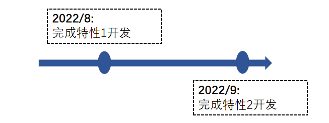
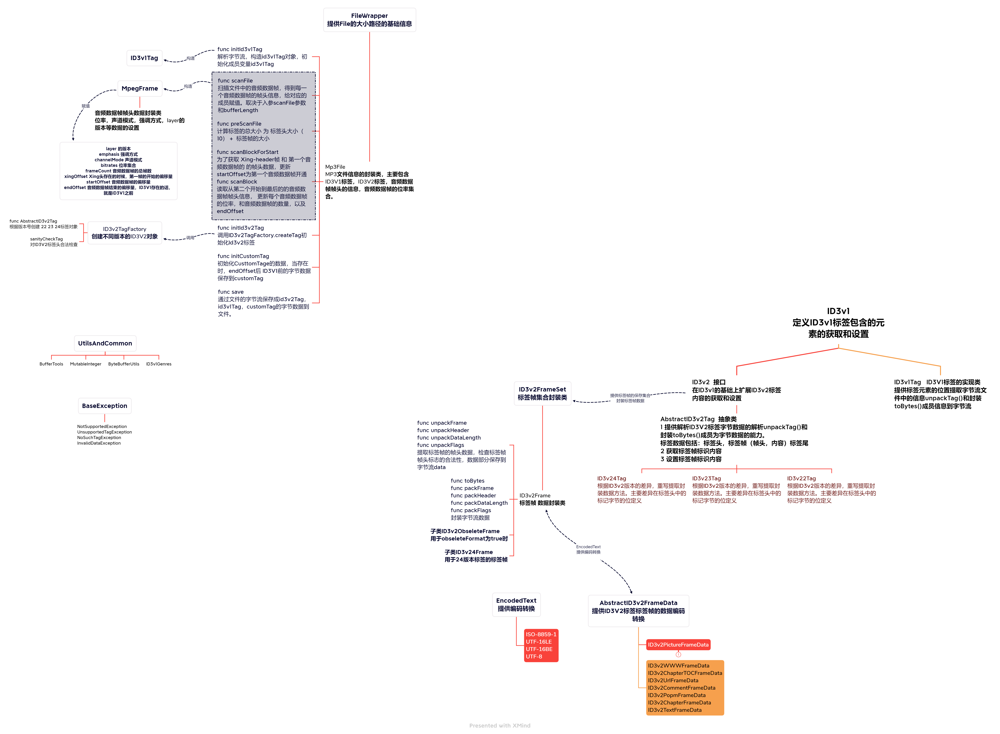

<div align="center">
<h1>mp3agic</h1>
</div>

<p align="center">


</p>


## 介绍

一个用于读取mp3文件和读取/操作ID3标记（ID3v1和ID3v2.2到ID3v2.4）的库。参考：https://github.com/mpatric/mp3agic

### 特性

- 🚀 特性1

读取、写入、添加和删除ID3v1标签。

- 🚀 特性2

读取、写入、添加和删除ID3v2标签，标签表示内容支持ISO-8859-1，UTF-16LE，UTF-16BE，UTF-8 4种编码； 读取音频数据帧帧头包含的数据信息；
判断vbr文件，获得每个音频数据帧的位率；在音频数据帧结尾和ID3v1标记之间添加或删除自定义标签。

### 路线

<p align="center">

</p>


##     软件架构

### 架构图

<p align="center">

</p>

### 源码目录

```shell
.
├── README.md
├── CHANGELOG.md
├── README.OPENSOURCE
├── mit-license.txt
├── doc
│   ├── assets
│   ├── cjcov
│   ├── design.md
│   └── feature_api.md
├── src
│   └── mp3agic 
│       ├──abstract_id3v2_frame_data.cj
│       ├──abstract_id3v2_tag.cj
│       ├──base_exception.cj
│       ├──buffer_tools.cj
│       ├──encoded_text.cj
│       ├──file_wrapper.cj
│       ├──id3v1.cj
│       ├──id3v1_genres.cj
│       ├──id3v1_tag.cj
│       ├──id3v2.cj
│       ├──id3v2_frame.cj
│       ├──id3v2_frame_set.cj
│       ├──id3v2_obselete_frame.cj
│       ├──id3v2_tag_factory.cj
│       ├──id3v2_text_frame_data.cj
│       ├──id3v22_tag.cj
│       ├──id3v23_tag.cj
│       ├──id3v24_frame.cj
│       ├──id3v24_tag.cj
│       ├──invalid_data_exception.cj
│       ├──mp3_file.cj
│       ├──mpeg_frame.cj
│       ├──mutable_integer.cj
│       ├──no_such_tag_exception.cj
│       ├──not_supported_exception.cj
│       └──unsupported_tag_exception.cj
└── test
    ├── HLT 
    ├── LLT
    └── UT
```

- `doc`是库的设计文档、提案、库的使用文档、LLT 覆盖率报告
- `src`是库源码目录
- `test`是测试用例所在目录，包括HLT用例、LLT 用例和UT用例

### 接口说明

主要是核心类和成员函数说明，详情请见 [API](./doc/feature_api.md)

## 使用说明

### 项目依赖

charset 包

下载地址：https://gitee.com/HW-PLLab/charset.git

okio 包：

下载地址：https://gitee.com/HW-PLLab/okio.git

cryptocj 包：

下载地址：https://gitee.com/HW-PLLab/cryptocj.git

### 编译

#### 1.外部项目依赖使用

 根目录下添加 `gitee_gate.cfg` 文件，内容如下 

```
[unittest]
ut = false                                               ---> ut = false : 单元测试不执行

[coverage]											
LLT = false											 ---> LLT = true: 会执行覆盖率测试脚本

[cangjie_library]
charset = https://gitee.com/HW-PLLab/charset.git		---> 依赖的三方库( 只支持仓颉语言的三方库 )
okio = https://gitee.com/HW-PLLab/okio.git				---> 依赖的三方库( 只支持仓颉语言的三方库 )
cryptocj = https://gitee.com/HW-PLLab/cryptocj.git		---> 依赖的三方库( 只支持仓颉语言的三方库 )

[cangjie_library_branch]
charset = v0.0.2									--->  依赖三方库的分支
okio = develop										--->  依赖三方库的分支
cryptocj = develop									--->  依赖三方库的分支

[external_library]

```

 在 `module.json` 的 `package_requires` 配置如下 

```
{
  "cjc_version": "0.36.4",
  "organization": "mp3agic",
  "name": "mp3agic",
  "description": "nothing here",
  "version": "0.0.6",
  "requires": {
    "charset": {
      "organization": "pllab",
      "version": "1.0.0",
      "path": "./charset"
    },
    "okio": {
      "organization": "cangjie",
      "version": "0.0.4",
      "path": "./okio"
    }
  },
  "package_requires": {},
  "foreign_requires": {},
  "output_type": "dynamic",
  "command_option": "-O2"
}
```


#### 2.本项目编译运行方式

##### 第一种方式

###### 引入charset，okio，cryptocj包

```
git clone https://gitee.com/HW-PLLab/charset.git
git clone https://gitee.com/HW-PLLab/okio.git
git clone https://gitee.com/HW-PLLab/cryptocj.git
```

将charset，okio，cryptocj包放在mp3agic目录下

###### 使用

1. 配置 module.json文件

2. 编译

   ```
   cpm build
   ```

3. 测试

   ```
   pm test test/UT
   unittest/bin/main
   ```

##### 第二种方式

######  引入 testJekins 包

 地址：https://gitee.com/HW-PLLab/testJekins 将 src 下 ci_test 放入 mp3agic 根目录下 

###### 使用

```shell
git clone https://gitee.com/HW-PLLab/mp3agic.git
git clone https://gitee.com/HW-PLLab/testJekins.git
cd mp3agic

cp -r ../testJekins/src/ci_test .;
python3 ci_test/main.py build   ---> 编译
python3 ci_test/main.py test;   ---> 执行 test/LLT 用例
```

test/LLT 用例书写参考：https://gitee.com/HW-PLLab/cangjie-library-pages/wikis 的门禁测试脚本使用方式


### 使用示例
注意，请记得配置MP3文件路径

对ID3V1标签的设置、获取和保存

```cangjie
获取和设置IDCV1标签数据:

from std import io.*
from mp3agic import mp3agic.*
from charset import charset.*
from charset import charset.singlebyte.*
from charset import charset.encoding.*

main() {
    var file = FileInfo("../../../../test/LLT/testFile/v1tag.mp3")
    var mp3File = Mp3File(file)
    if (mp3File.hasId3v1Tag()){
        var id3v1Tag = mp3File.getId3v1Tag().getOrThrow()
        showId3v1(id3v1Tag)
        id3v1Tag.setTrack(Option<String>.Some(""))
        id3v1Tag.setArtist(Option<String>.Some("NEWARTIST12345678901234567890"))
        id3v1Tag.setTitle(Option<String>.Some("NEWTITLE12345678901234567890"))
        id3v1Tag.setAlbum(Option<String>.Some("NEWALBUM1234567890123456789011111111111111111111111111"))
        id3v1Tag.setYear(Option<String>.Some("19940821"))
        id3v1Tag.setGenre(Option<Int64>.Some(20))
        id3v1Tag.setComment(Option<String>.Some("NEWCOMMENT123456"))
    }
    mp3File.save("../../../../test/LLT/testFile/v1tagNew.mp3")
    var file2 = FileInfo("../../../../test/LLT/testFile/v1tagNew.mp3")
    var mp3FileNew = Mp3File(file2)
    if (mp3FileNew.hasId3v1Tag()){
        var id3v1Tag = mp3FileNew.getId3v1Tag().getOrThrow()
        showId3v1(id3v1Tag)
        checkId3v1(id3v1T    
    }
    File.delete("../../../../test/LLT/testFile/v1tagNew.mp3")
    0
}
func checkId3v1(id3v1Tag: ID3v1){
    if (id3v1Tag.getVersion() != "0") {
        throw RuntimeException("Expected non conformance")
    }
    if (id3v1Tag.getTrack() != "") {
        throw RuntimeException("Expected non conformance")
    }
    if (id3v1Tag.getArtist() != "NEWARTIST12345678901234567890") {
        throw RuntimeException("Expected non conformance")
    }
    if (id3v1Tag.getTitle() != "NEWTITLE12345678901234567890") {
        throw RuntimeException("Expected non conformance")
    }
    if (id3v1Tag.getAlbum() != "NEWALBUM1234567890123456789011") {
        throw RuntimeException("Expected non conformance")
    }
    if (id3v1Tag.getYear() != "1994") {
        throw RuntimeException("Expected non conformance")
    }
    if (id3v1Tag.getGenre() != 20) {
        throw RuntimeException("Expected non conformance")
    }
    if (id3v1Tag.getComment() != "NEWCOMMENT123456") {
        throw RuntimeException("Expected non conformance")
    }
    if (id3v1Tag.getGenreDescription() != "Alternative") {
        throw RuntimeException("Expected non conformance")
    }
}

func showId3v1(id3v1Tag: ID3v1) {
    var version = id3v1Tag.getVersion()
    var track = id3v1Tag.getTrack()
    var artist = id3v1Tag.getArtist()
    var title = id3v1Tag.getTitle()
    var album = id3v1Tag.getAlbum()
    var year = id3v1Tag.getYear()
    var genre = id3v1Tag.getGenre()
    var des = id3v1Tag.getGenreDescription()
    var comm = id3v1Tag.getComment()
    println("version ==> ${version}")
    println("track ==> ${track}")
    println("artist ==> ${artist}")
    println("title ==> ${title}")
    println("album ==> ${album}")
    println("year ==> ${year}")
    println("genre ==> ${genre}")
    println("comm ==> ${comm}")
    println("des ==> ${des}")
}
```

执行结果如下：

```cangjie
执行结果:
version ==> 1
track ==> Some(1)
artist ==> Some(ARTIST123456789012345678901234)
title ==> Some(TITLE1234567890123456789012345)
album ==> Some(ALBUM1234567890123456789012345)
year ==> Some(2001)
genre ==> Some(13)
comm ==> Some(COMMENT123456789012345678901)
des ==> Pop
version ==> 0
track ==> Some()
artist ==> Some(NEWARTIST12345678901234567890)
title ==> Some(NEWTITLE12345678901234567890)
album ==> Some(NEWALBUM1234567890123456789011)
year ==> Some(1994)
genre ==> Some(20)
comm ==> Some(NEWCOMMENT123456)
des ==> Alternative
```

获取MP3音频数据相关成员

```cangjie
from mp3agic import mp3agic.*
from std import io.*
from std import collection.*
from charset import charset.*
from charset import charset.singlebyte.*
from charset import charset.encoding.*

main() {
    //v1andv23andcustomtags.mp3
    var mp3File: Mp3File = Mp3File("../../../../test/LLT/id3v2Test/testv2File/v1andv23andcustomtags.mp3")
    var startOffset:Int32 = mp3File.getStartOffset()
    var xingOffset:Int32 = mp3File.getXingOffset()
    var endOffset:Int32 = mp3File.getEndOffset()
    var frameCount:Int32 = mp3File.getFrameCount()
    var bitrate:Int32 = mp3File.getBitrate()
    var xingBitrate:Int32 = mp3File.getXingBitrate()
    var bitrates: Map<Int32, MutableInteger> = mp3File.getBitrates()
    var channelMode: String = mp3File.getChannelMode()
    var emphasis: String = mp3File.getEmphasis()
    var layer: String = mp3File.getLayer()
    var lengthInMilliseconds: Int64 = mp3File.getLengthInMilliseconds()
    var lengthInSeconds: Int64 = mp3File.getLengthInSeconds()
    var modeExtension: String = mp3File.getModeExtension()
    var sampleRate: Int32 = mp3File.getSampleRate()
    var version: String = mp3File.getVersion()
    var copyright: Bool = mp3File.isCopyright()
    var original: Bool = mp3File.isOriginal()
    var vbr: Bool = mp3File.isVbr()
    println("startOffset ===> ${startOffset}")
    println("xingOffset ===> ${xingOffset}")
    println("endOffset ===> ${endOffset}")
    println("frameCount ===> ${frameCount}")
    println("bitrate ===> ${bitrate}")
    println("xingBitrate ===> ${xingBitrate}")
    println("channelMode ===> ${channelMode}")
    println("emphasis ===> ${emphasis}")
    println("layer ===> ${layer}")
    println("lengthInMilliseconds ===> ${lengthInMilliseconds}")
    println("lengthInSeconds ===> ${lengthInSeconds}")
    println("modeExtension ===> ${modeExtension}")
    println("sampleRate ===> ${sampleRate}")
    println("version ===> ${version}")
    println("copyright ===> ${copyright}")
    println("original ===> ${original}")
    println("vbr ===> ${vbr}")
    for ( (k,v) in bitrates ){
        println("bitrates key ===> ${k}")
        println("bitrates val ===> ${v.getValue()}")
    }
    0
}
```

执行结果如下：

```cangjie
执行结果:
startOffset ===> 1516
xingOffset ===> 1099
endOffset ===> 3967
frameCount ===> 6
bitrate ===> 125
xingBitrate ===> 128
channelMode ===> Joint stereo
emphasis ===> None
layer ===> III
lengthInMilliseconds ===> 156
lengthInSeconds ===> 0
modeExtension ===> None
sampleRate ===> 44100
version ===> 1.0
copyright ===> false
original ===> true
vbr ===> true
bitrates key ===> 224
bitrates val ===> 1
bitrates key ===> 112
bitrates val ===> 1
bitrates key ===> 96
bitrates val ===> 2
bitrates key ===> 192
bitrates val ===> 1
bitrates key ===> 32
bitrates val ===> 1
```

## 参与贡献

欢迎给我们提交PR，欢迎给我们提交Issue，欢迎参与任何形式的贡献。