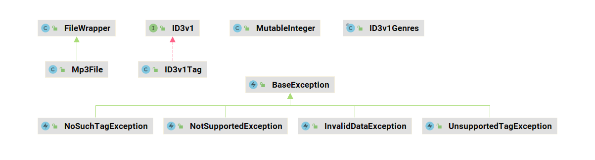

### 三方库设计说明

#### 1 需求场景分析

一个用于读取mp3文件和读取/操作ID3标记（ID3v1和ID3v2.2到ID3v2.4）的库。

#### 2 三方库对外提供的特性

（1） 读取、写入、添加和删除ID3v1标签。

（2） 读取、写入、添加和删除ID3v2标签，标签表示内容支持ISO-8859-1，UTF-16LE，UTF-16BE，UTF-8 4种编码；
读取音频数据帧帧头包含的数据信息；判断vbr文件，获得每个音频数据帧的位率；在音频数据帧结尾和ID3v1标记之间添加或删除自定义标签。

#### 3 License分析

MIT License

|  Permissions   | Limitations  |
|  ----  | ----  |
| Commercial use | Liability |
| Modification  | Warranty |
| Distribution  |   |
| Private use   |   |

#### 4 依赖分析

依赖

java.nio 中的Charset，ByteBuffer，CharBuffer，file，SeekableByteChannel

java.io 中的 File，path


#### 5 特性设计文档

##### 5.1 核心特性1

###### 5.1.1 特性介绍

    读取、写入、添加和删除ID3v1标签。

###### 5.1.2 实现方案

    通过Mp3File读取文件，拿到最后128个字节解析数据，提供相应的pack方法，对设置的值继续转换，然后通过Mp3File提供的save方法进行保存。

###### 5.1.3 接口设计



💡 FileWrapper 文件的包装类型，获得文件的基本信息。

| 成员函数 | 入参 | 返回值 | 作用描述 |
| --- | --- |  --- | --- |
| init   | filename: String | Unit | 通过文件名构造，filename：为文件路径和文件名称 |
| init   | file: FileInfo | Unit |  通过文件类型构造  |
| getFilename   | 无 | String | 获得文件名称 |
| getLength   |  | Int64 | 获得文件字节长度 |

💡 Mp3File 构建MP3文件并根据文件初始化各个部分的数据。

| 成员函数 | 入参 | 返回值 | 作用描述 |
| --- | --- | --- | ---  |
| init   | filename: String | Unit | 通过文件构造，filename：文件路径和文件名称 |
| init   | filename: String, bufferLength: Int32| Unit | 通过文件构造并且传入需要扫描文件的长度，fileNamme：文件路径和文件名称，可以换成FileInfo类型；bufferLength：规则扫描的字节容器的长度，默认值为65536 |
| init   | filename: String, scanFile: Bool | Unit | 通过文件构造并，fileNamme：文件路径和文件名称；scanFile：规定是否扫描所有音频数据帧|
| init   | filename: String, bufferLength: Int32, scanFile: Bool | Unit | 构造方法，fileNamme：文件路径和文件名称，可以换成FileInfo类型；scanFile：规定是否扫描所有音频数据帧 |
| hasId3v1Tag   | 无 | Bool |是否包含ID3V1标签 |
| getId3v1Tag   | 无 | Option\<ID3v1\> |得到ID3V1标签对象 |
| setId3v1Tag   | 无 | Unit |设置ID3V1标签 |
| removeId3v1Tag | 无 | Unit | 移除ID3V1标签 |
| save  | newFilename: String | Unit | 保存文件，filename：文件路径和文件名称 |

💡 ID3v1 标签的接口类型。

| 接口名 | 入参 | 返回值 | 作用描述 |
| --- | --- | --- | ---  |
| getVersion   | 无 | String | 获得子版本 |
| getTrack   | 无 | String | 获取成员Track |
| setTrack   | track: String | Unit | 设置成员Track |
| getArtist   | 无 | String | 获取作者 | 
| setArtist   | artist: String | Unit | 设置作者 |
| getTitle   | 无 | String | 获取标题 |
| setTitle   | title: String | Unit | 设置标题 |
| getAlbum   | 无 | String | 获取专辑 |
| setAlbum   | album: String | Unit |设置专辑 |
| getYear   | 无 | String |获取年份 |
| setYear   | year: String | Unit | 设置年份，year：年份的字符串，最大存4个字节 |
| getGenre   | 无 | Int32 |获取风格 |
| setGenre   | genre: Int32 | Unit | 设置风格，genre：风格数字在147内存在对应描述，超出时会显示Unknown |
| getGenreDescription   | 无 | String |设置风格描述 |
| getComment   | 无 | String | 获取附注 |
| setComment   | comment: String | Unit | 设置附注 |
| toBytes   | 无 | Array\<Int8\> | 转换为字节流数据 |

💡 ID3V1Tag 标签类型ID3v1的实现类。

| 成员变量 | 类型 | 默认值 | 作用描述 |
| --- | --- | --- | --- |
| TAG_LENGTH | Int32 | 128 | ID3V1的长度，位于MP3尾部固定长度 |
| 成员函数 | 入参 | 返回值 | 作用描述 | 
| init   | 无 | Unit | 无参构造 |
| init   | bytes: Array\<Int8\> | Unit | 构造函数，bytes：为整个ID3V1标签的字节数据 |
| packTag   | bytes: Array\<Int8\> | Unit | 提取标签数据包括GA, 作者，标题，专辑，年份，风格类型，附注，track，bytes：为整个ID3V1标签的字节数据 |


💡 BaseException 基础异常类，分为4个子类，NotSupportedException，UnsupportedTagException，NoSuchTagException，InvalidDataException。

| 成员函数 | 入参 | 返回值 | 作用描述 |
| --- | --- | --- | --- |
| init   | 无 | Unit | 无参构造 |
| init   |message: String | Unit | 构造函数，message：异常信息描述 |
| init   |message: String, cause: Throwable | Unit | 构造函数，message：异常信息描述；cause：异常类型 |
| getDetailedMessage   | 无 | String | 获得异常描述 |


💡 类描述 MutableInteger数值类型，用于创建id编号。

| 成员函数 | 入参 | 返回值 | 作用描述 |
| --- | --- | --- | --- |
| init   | value: Int32 | Unit | 构造函数 |
| increment   | 无 | Unit | 增长函数 |
| getValue   | 无 | Int32 | 得到数据值 |
| setValue   | value: Int32 | Unit | 设置数据值 |

💡 ID3v1Genres 标识数据类，曲风。

| 成员变量 | 类型 | 默认值 | 作用描述 |
| --- | --- | --- | --- |
| GENRES | Array\<String\> | 曲风字典 | Genres数值对应曲风描述 |
| 成员函数 | 入参 | 返回值 | 作用描述 | 
| matchGenreDescription | description: Option<String> | Int32 | 获取Genres对应的序号，description：成员GENRES中的147种风格之一 |

###### 5.1.4 展示示例
```cangjie
获取和设置IDCV1标签数据:

from std import io.*
from mp3agic import mp3agic.*
from charset import charset.*
from charset import charset.singlebyte.*
from charset import charset.encoding.*

main() {
    var file = FileInfo("../../../../test/LLT/testFile/v1tag.mp3")
    var mp3File = Mp3File(file)
    if (mp3File.hasId3v1Tag()){
        var id3v1Tag = mp3File.getId3v1Tag().getOrThrow()
        showId3v1(id3v1Tag)
        id3v1Tag.setTrack(Option<String>.Some(""))
        id3v1Tag.setArtist(Option<String>.Some("NEWARTIST12345678901234567890"))
        id3v1Tag.setTitle(Option<String>.Some("NEWTITLE12345678901234567890"))
        id3v1Tag.setAlbum(Option<String>.Some("NEWALBUM1234567890123456789011111111111111111111111111"))
        id3v1Tag.setYear(Option<String>.Some("19940821"))
        id3v1Tag.setGenre(Option<Int64>.Some(20))
        id3v1Tag.setComment(Option<String>.Some("NEWCOMMENT123456"))
    }
    mp3File.save("../../../../test/LLT/testFile/v1tagNew.mp3")
    var file2 = FileInfo("../../../../test/LLT/testFile/v1tagNew.mp3")
    var mp3FileNew = Mp3File(file2)
    if (mp3FileNew.hasId3v1Tag()){
        var id3v1Tag = mp3FileNew.getId3v1Tag().getOrThrow()
        showId3v1(id3v1Tag)
        checkId3v1(id3v1T    
    }
    File.delete("../../../../test/LLT/testFile/v1tagNew.mp3")
    0
}
func checkId3v1(id3v1Tag: ID3v1){
    if (id3v1Tag.getVersion() != "0") {
        throw RuntimeException("Expected non conformance")
    }
    if (id3v1Tag.getTrack() != "") {
        throw RuntimeException("Expected non conformance")
    }
    if (id3v1Tag.getArtist() != "NEWARTIST12345678901234567890") {
        throw RuntimeException("Expected non conformance")
    }
    if (id3v1Tag.getTitle() != "NEWTITLE12345678901234567890") {
        throw RuntimeException("Expected non conformance")
    }
    if (id3v1Tag.getAlbum() != "NEWALBUM1234567890123456789011") {
        throw RuntimeException("Expected non conformance")
    }
    if (id3v1Tag.getYear() != "1994") {
        throw RuntimeException("Expected non conformance")
    }
    if (id3v1Tag.getGenre() != 20) {
        throw RuntimeException("Expected non conformance")
    }
    if (id3v1Tag.getComment() != "NEWCOMMENT123456") {
        throw RuntimeException("Expected non conformance")
    }
    if (id3v1Tag.getGenreDescription() != "Alternative") {
        throw RuntimeException("Expected non conformance")
    }
}

func showId3v1(id3v1Tag: ID3v1) {
    var version = id3v1Tag.getVersion()
    var track = id3v1Tag.getTrack()
    var artist = id3v1Tag.getArtist()
    var title = id3v1Tag.getTitle()
    var album = id3v1Tag.getAlbum()
    var year = id3v1Tag.getYear()
    var genre = id3v1Tag.getGenre()
    var des = id3v1Tag.getGenreDescription()
    var comm = id3v1Tag.getComment()
    println("version ==> ${version}")
    println("track ==> ${track}")
    println("artist ==> ${artist}")
    println("title ==> ${title}")
    println("album ==> ${album}")
    println("year ==> ${year}")
    println("genre ==> ${genre}")
    println("comm ==> ${comm}")
    println("des ==> ${des}")
}
```

```cangjie
执行结果:
version ==> 1
track ==> Some(1)
artist ==> Some(ARTIST123456789012345678901234)
title ==> Some(TITLE1234567890123456789012345)
album ==> Some(ALBUM1234567890123456789012345)
year ==> Some(2001)
genre ==> Some(13)
comm ==> Some(COMMENT123456789012345678901)
des ==> Pop
version ==> 0
track ==> Some()
artist ==> Some(NEWARTIST12345678901234567890)
title ==> Some(NEWTITLE12345678901234567890)
album ==> Some(NEWALBUM1234567890123456789011)
year ==> Some(1994)
genre ==> Some(20)
comm ==> Some(NEWCOMMENT123456)
des ==> Alternative
```


##### 5.2 核心特性2

###### 5.2.1 特性介绍

    读取、写入、添加和删除ID3v2标签，标签表示内容支持ISO-8859-1，UTF-16LE，UTF-16BE，UTF-8 4种编码；
    读取音频数据帧帧头包含的数据信息；判断vbr文件，获得每个音频数据帧的位率；在音频数据帧结尾和ID3v1标记之间添加或删除自定义标签。

###### 5.2.2 实现方案

    对Mp3File进行扩展添加，ID3V2类型，音频数据帧帧头相关成员和方法。通过Mp3File构建成员，扫描文件ID3V2标签，每一个音频数据帧，标签尾，自定义标签
    对每种成员进行构造，提供相应的pack和unpack能力。对标签帧的标识数据提供编码解码能力。支持对标ID3V2签数据的修改和保存。

###### 5.2.3 接口设计

💡 Mp3File 根据文件初始化各个部分的数据。较特性1中扩展了内容。

| 成员函数 | 入参 | 返回值 | 作用描述 |
| --- | --- | --- | ---  |
| hasId3v2Tag | 无 | Bool | 是否包含ID3V2标签 |
| getId3v2Tag | 无 | Option<ID3v2> | 获得ID3V1标签 |
| setId3v2Tag | id3v2Tag: Option<ID3v2> | Unit | 设置ID3V1标签 |
| removeId3v2Tag | 无 | Unit | 移除ID3V2标签 |
| hasCustomTag | 无 | Bool | 是否包含CustomTag标签 |
| getCustomTag | 无 | Option<Array<Int8>> | 获得CustomTag标签 |
| setCustomTag | customTag: Option<Array<Int8>> | Unit | 设置CustomTag标签 |
| removeId3v1Tag | 无 | Unit | 移除CustomTag标签 |
| getStartOffset | 无 | Int32 | 获得音频数据帧开始的偏移量,如果存在Xing-header会越过Xing-header |
| getXingOffset | 无 | Int32 | 获得Xing-header开始的偏移量 |
| getEndOffset | 无 | Int32 | 获得音频数据帧结束的偏移量，如果有customTag在customTag之前 |
| getFrameCount | 无 | Int32 | 获得音频数据帧的数量 |
| getBitrate | 无 | Int32 | 获得位率，若是可变位率的音频，该数值为平均位率 |
| getXingBitrate | 无 | Int32 | 获得Xing-header帧的位率 |
| getBitrates | 无 | Map<Int32, MutableInteger> | 获得位率集合，若scanfile为false时。该一个size只有1为第一个音频数据真的位率。集合的key为位率的值，MutableInteger 记录该位率出现的次数 |
| getChannelMode | 无 | String | 获取渠道模式 |
| getEmphasis | 无 | String | 获取强调信息 |
| getLayer | 无 | String | 获取压缩级别 |
| getLengthInMilliseconds | 无 | Int64 | 获取MP3长度，单位毫秒 |
| getLengthInSeconds | 无 | Int64 | 获取MP3长度，单位秒 |
| getModeExtension | 无 | String | 获取模式扩展 |
| getSampleRate | 无 | Int32 | 获取音频采样率 |
| getVersion | 无 | String | 获取版本 |
| isCopyright | 无 | Bool | 是否有版权 |
| isOriginal | 无 | Bool | 是否是原版 |
| isVbr | 无 | Bool | 是否为VBR编码（可变位率），不是为 CBR编码 |
| hasXingFrame | 无 | Bool | 断是否有 xing帧 |

💡 ID3v2 标签的接口类型，继承ID3v1。

| 接口名 | 入参 | 返回值 | 作用描述 |
| --- | --- | --- | ---  |
| getPadding   | 无 | Bool | 获得是否有填充 |
| hasFooter   | 无 | Bool | 是否存在标签尾 |
| setFooter   | footer: Bool | Unit | 设置标签尾是否存在 |
| hasUnsynchronisation   | 无 | Bool | 是否存在不同步标识 |
| setUnsynchronisation   | unsynchronisation: Bool | Unit | 设置不同步标识 |
| getBPM   | 无 | Int32 | 获得标签帧对应标识数据 TBPM|
| setBPM   | bpm: Int32 | Unit | 设置标签帧对应标识数据 TBPM|
| getGrouping   | 无 | String | 获得标签帧对应标识数据 TIT1|
| setGrouping   | grouping: String | Unit | 设置标签帧对应标识数据 TIT1|
| getKey   | 无 | String | 获得标签帧对应标识数据 TKEY |
| setKey   | key: String | Unit | 设置标签帧对应标识数据 TKEY|
| getDate   | 无 | String | 获得标签帧对应标识数据 TDAT|
| setDate   | date: String | Unit | 设置标签帧对应标识数据 TDAT|
| getComposer   | 无 | String | 获得标签帧对应标识数据 TCOM|
| setComposer   | composer: String | Unit | 设置标签帧对应标识数据 TCOM|
| getPublisher   | 无 | String | 获得标签帧对应标识数据 TPUB |
| setPublisher   | publisher: String | Unit | 设置标签帧对应标识数据 TPUB |
| getOriginalArtist   | 无 | Unit | 获得标签帧对应标识数据 TOPE |
| setOriginalArtist   | publisher: String | Unit | 设置标签帧对应标识数据 TOPE |
| getAlbumArtist   | 无 | String | 获得标签帧对应标识数据 TPE2|
| setAlbumArtist   | albumArtist: String | Unit | 设置标签帧对应标识数据 TPE2|
| getCopyright   | 无 | String | 获得标签帧对应标识数据 TCOP|
| setCopyright   | copyright: String | Unit | 设置标签帧对应标识数据 TCOP|
| getArtistUrl   | 无 | String | 获得标签帧对应标识数据 WOAR|
| setArtistUrl   | url: String | Unit | 设置标签帧对应标识数据 WOAR|
| getCommercialUrl   | 无 | String | 获得标签帧对应标识数据 WCOM |
| setCommercialUrl   | url: String | Unit | 设置标签帧对应标识数据 WCOM |
| getCopyrightUrl   | 无 | String | 获得标签帧对应标识数据 WCOP |
| setCopyrightUrl   | url: String | Unit | 设置标签帧对应标识数据 WCOP |
| getAudiofileUrl   | 无 | String | 获得标签帧对应标识数据 WOAF |
| setAudiofileUrl   | url: String | Unit | 设置标签帧对应标识数据 WOAF |
| getAudioSourceUrl   | 无 | String | 获得标签帧对应标识数据 WOAS |
| setAudioSourceUrl   | url: String | Unit | 设置标签帧对应标识数据 WOAS |
| getRadiostationUrl   | 无 | String | 获得标签帧对应标识数据 WORS|
| setRadiostationUrl   | url: String | Unit | 设置标签帧对应标识数据 WORS|
| getPaymentUrl   | 无 | String | 获得标签帧对应标识数据 WPAY|
| setPaymentUrl   | url: String | Unit | 设置标签帧对应标识数据 WPAY|
| getPublisherUrl   | 无 | String | 获得标签帧对应标识数据 WPUB |
| setPublisherUrl   | url: String | Unit | 设置标签帧对应标识数据 WPUB |
| getUrl   | 无 | String | 获得标签帧对应标识数据 WXXX |
| setUrl   | url: String | Unit | 设置标签帧对应标识数据 WXXX|
| getPartOfSet   | 无 | String | 获得标签帧对应标识数据 TPOS|
| setPartOfSet   | partOfSet: String | Unit | 设置标签帧对应标识数据 TPOS|
| isCompilation   | 无 | Bool | 是否存在标签帧对应标识 TCMP |
| setCompilation   | compilation: Bool | Unit | 设置标签帧对应标识数据 TCMP |
| getChapters   | 无 |  ArrayList\<ID3v2ChapterFrameData\> | 获得标签帧对应标识数据 CHAP |
| setChapters   | chapters: ArrayList\<ID3v2ChapterFrameData\> | Unit | 设置标签帧对应标识数据 CHAP |
| getChapterTOC   | 无 |  ArrayList\<ID3v2ChapterTOCFrameData\> | 获得标签帧对应标识数据 CTOC|
| setChapterTOC   | chapters: ArrayList\<ID3v2ChapterFrameData\> | Unit | 设置标签帧对应标识数据 CTOC|
| getEncoder   | 无 | String | 获得标签帧对应标识数据 TENC |
| setEncoder   | encoder: String | Unit | 设置标签帧对应标识数据 TENC |
| getAlbumImage   | 无 | Array\<Int8\> | 获得标签帧对应标识数据 APIC|
| setAlbumImage   | albumImage: Array<Int8>, mimeType: String | Unit | 设置标签帧对应标识数据 APIC|
| setAlbumImage   | albumImage: Array<Int8>, mimeType: String, imageType: Int8, imageDescription: String | Unit | 设置标签帧对应标识数据 APIC|
| clearAlbumImage  | 无 | Unit | 清除标签帧对应标识数据 APIC|
| getWmpRating  | 无 | Int32 | 获得标签帧对应标识数据 POPM|
| setWmpRating  | rating: Int32 | Unit | 设置标签帧对应标识数据 POPM|
| getItunesComment  | 无 | String | 获得标签帧对应标识数据 COMM|
| setItunesComment  | itunesComment: String | Unit | 设置标签帧对应标识数据 COMM|
| getLyrics  |  无 | String | 获得标签帧对应标识数据 USLT|
| setLyrics  | lyrics: String | Unit | 设置标签帧对应标识数据 USLT|
| setGenreDescription  | text: String | Unit | 设置标签帧对应标识数据 TCON|
| getDataLength  | 无 | Int32 | 获得ID3V2的数据长读，计算标签头的 6~10个字节，标签帧的大小 并不包含标签头的10个字节 |
| getLength  | 无 | Int32 | 获得ID3V2标签长度 |
| getObseleteFormat  | 无 | Bool | 过得观察模式标识 |
| getFrameSets  | 无 | Map\<String, ID3v2FrameSet\> | 获取ID3V2标签帧集合 |
| clearFrameSet  | id: String | Unit | 移除制定标识的标签帧，id：标签帧标识 |

💡 AbstractID3v2Tag ID3V2接口的实现类，用来获得和设置标签数据，AbstractID3v2Tag存在ID3v22Tag，ID3v23Tag，ID3v24Tag的子版本类型提供差异化的数据解析和封装。

| 成员函数 | 入参 | 返回值 | 作用描述 |
| --- | --- | --- | --- |
| init   | 无 | Unit | 构造函数 |
| init   | bytes: Array\<Int8\> | Unit | 构造函数，bytes：整个ID3V2标签的字节数据；obseleteFormat：默认为false |
| init   | bytes: Array\<Int8\>, obseleteFormat: Bool | Unit | bytes：整个ID3V2标签的字节数据；obseleteFormat：数据是否为观察格式数据 |

💡 ID3v2TagFactory提供基本的检查方法和创建不同版本的ID3V2标签对象。

| 成员函数 | 入参 | 返回值 | 作用描述 |
| --- | --- | --- | --- |
| createTag | bytes: Array\<Int8\> | Unit | 根据解析的版本号创建对应子版本的标签对象，bytes：整个ID3V2标签的字节数据 |
| sanityCheckTag | bytes: Array\<Int8\> | Unit | 标签头内容进行检查，包括标签头长度10字节， 前3个字节的内容， 和子版本号进行检查，bytes：标签头的字节数据|

💡 MpegFrame音频数据帧数据的封装类型。主要为音频数据帧的帧头部分得到音频的参数数据。

| 成员函数 | 入参 | 返回值 | 作用描述 |
| --- | --- | --- | --- |
| init | 无 | frameData: Array\<Int8\> | 构造方法，音频数据帧帧头位于前4个字节，frameData：音频数据帧帧头字节数据 |
| init | 无 | frameData1: Int8, frameData2: Int8, frameData3: Int8, frameData4: Int8 | 构造方法，音频数据帧帧头位于前4个字节，入参分别为音频数据帧帧头的4个字节数据 |
| getBitrate | 无 | Int32 | 获得音频数据帧帧头数据位率 |
| getChannelMode | 无 | Int32 | 获得音频数据帧帧头数据声道模式 |
| isCopyright | 无 | Int32 | 获得音频数据帧帧头数据版权 |
| getEmphasis | 无 | Int32 | 获得音频数据帧帧头数据强调方式 |
| getLayer | 无 | Int32 | 获得音频数据帧帧头数据layer版本 |
| getModeExtension | 无 | Int32 | 获得音频数据帧帧头数据扩充模式 |
| isOriginal | 无 | Int32 | 获得音频数据帧帧头数据原版标志 |
| getSampleRate | 无 | Int32 | 获得音频数据帧帧头数据采样率 |
| getVersion | 无 | Int32 | 获得音频数据帧帧头数据媒体版本 |
| getLengthInBytes | 无 | Int32 | 获得音频数据帧长 |

💡 ID3v2Frame 标签帧类型，用于封装和解析标签帧的数据，ID3v2ObseleteFrame，ID3v24Frame子类提供差异化实现。

| 成员函数 | 入参 | 返回值 | 作用描述 |
| --- | --- | --- | --- |
| init | buffer: Array\<Int8\>, offset: Int32 | Unit | 构造方法，buffer：整个ID3V2标签字节数据；offset：上一次音频数据帧结束的偏移量 |
| init | id: String, data: Array\<Int8\> | Unit | 构造方法，id标签帧的标识；data：标签帧字节数据 |
| toBytes | 无 | Array\<Int8\> | 将标签帧对象转换为字节数据 |
| getId | 无 | String | 得到标签帧标识 |
| getDataLength | 无 | Int32 | 得到标签帧数据长度 |
| getLength | 无 | Int32 | 得到标签帧长度 |
| getData | 无 | Array\<Int8\> | 得到标签帧数据 |
| setData | data: Array\<Int8\> | Unit | 设置标签帧数据，data：标签帧字节数据 |
| hasDataLengthIndicator | 无 | Bool | 是否存在数据长读指示器标识 |
| hasCompression | 无 | Bool | 是否存在压缩标识 |
| hasEncryption | 无 | Bool | 是否存在加密标识 |
| hasGroup | 无 | Bool | 是否存在分组标识 |
| hasPreserveFile | 无 | Bool | 是否存在文件更改标识 |
| hasPreserveTag | 无 | Bool | 是否存在文件更改标识 |
| isReadOnly | 无 | Bool | 是否存只读标识 |
| hasUnsynchronisation | 无 | Bool | 是否不同步标识 |

💡 ID3v2FrameSet ID3v2标签帧集合封装类。

| 成员函数 | 入参 | 返回值 | 作用描述 |
| --- | --- | --- | --- |
| init | id: String | Unit | 构造方法，id：类型的唯一标识id |
| getId | 无 | String | 返回该对象的id标识 |
| clear | 无 | Unit | 清空标签帧集合 |
| addFrame | frame: ID3v2Frame | Unit | 添加标签帧，frame：标签帧对象 |
| getFrames | 无 | ArrayList<ID3v2Frame> | 得到标签帧集合 |

💡 AbstractID3v2FrameData用于封装标签帧对象获得设置和编码解码的标识的内容，跟句标识不同内容有分了8个子类型，ID3v2PictureFrameData，ID3v2TextFrameData，
ID3v2UrlFrameData，ID3v2ChapterTOCFrameData，ID3v2PopmFrameData，ID3v2ChapterFrameData，ID3v2CommentFrameData，ID3v2WWWFrameData。

| 成员函数 | 入参 | 返回值 | 作用描述 |
| --- | --- | --- | --- |
| init | unsynchronisation: Bool | Unit | 构造方法，unsynchronisation：设置不同步标识 |

💡 工具类 ByteBufferUtils，BufferTools；EncodedText编码解析类，用于在设置或者获取标签帧标识数据的时候的时候进行编码解码。

###### 5.2.4 展示示例
```cangjie
from mp3agic import mp3agic.*
from std import io.*
from std import collection.*
from charset import charset.*
from charset import charset.singlebyte.*
from charset import charset.encoding.*

main() {
    //v1andv23andcustomtags.mp3
    var mp3File: Mp3File = Mp3File("../../../../test/LLT/id3v2Test/testv2File/v1andv23andcustomtags.mp3")
    var startOffset:Int32 = mp3File.getStartOffset()
    var xingOffset:Int32 = mp3File.getXingOffset()
    var endOffset:Int32 = mp3File.getEndOffset()
    var frameCount:Int32 = mp3File.getFrameCount()
    var bitrate:Int32 = mp3File.getBitrate()
    var xingBitrate:Int32 = mp3File.getXingBitrate()
    var bitrates: Map<Int32, MutableInteger> = mp3File.getBitrates()
    var channelMode: String = mp3File.getChannelMode()
    var emphasis: String = mp3File.getEmphasis()
    var layer: String = mp3File.getLayer()
    var lengthInMilliseconds: Int64 = mp3File.getLengthInMilliseconds()
    var lengthInSeconds: Int64 = mp3File.getLengthInSeconds()
    var modeExtension: String = mp3File.getModeExtension()
    var sampleRate: Int32 = mp3File.getSampleRate()
    var version: String = mp3File.getVersion()
    var copyright: Bool = mp3File.isCopyright()
    var original: Bool = mp3File.isOriginal()
    var vbr: Bool = mp3File.isVbr()
    println("startOffset ===> ${startOffset}")
    println("xingOffset ===> ${xingOffset}")
    println("endOffset ===> ${endOffset}")
    println("frameCount ===> ${frameCount}")
    println("bitrate ===> ${bitrate}")
    println("xingBitrate ===> ${xingBitrate}")
    println("channelMode ===> ${channelMode}")
    println("emphasis ===> ${emphasis}")
    println("layer ===> ${layer}")
    println("lengthInMilliseconds ===> ${lengthInMilliseconds}")
    println("lengthInSeconds ===> ${lengthInSeconds}")
    println("modeExtension ===> ${modeExtension}")
    println("sampleRate ===> ${sampleRate}")
    println("version ===> ${version}")
    println("copyright ===> ${copyright}")
    println("original ===> ${original}")
    println("vbr ===> ${vbr}")
    for ( (k,v) in bitrates ){
        println("bitrates key ===> ${k}")
        println("bitrates val ===> ${v.getValue()}")
    }
    0
}
```

```cangjie
执行结果:
startOffset ===> 1516
xingOffset ===> 1099
endOffset ===> 3967
frameCount ===> 6
bitrate ===> 125
xingBitrate ===> 128
channelMode ===> Joint stereo
emphasis ===> None
layer ===> III
lengthInMilliseconds ===> 156
lengthInSeconds ===> 0
modeExtension ===> None
sampleRate ===> 44100
version ===> 1.0
copyright ===> false
original ===> true
vbr ===> true
bitrates key ===> 224
bitrates val ===> 1
bitrates key ===> 112
bitrates val ===> 1
bitrates key ===> 96
bitrates val ===> 2
bitrates key ===> 192
bitrates val ===> 1
bitrates key ===> 32
bitrates val ===> 1

```


#### 🚀 6 架构图


